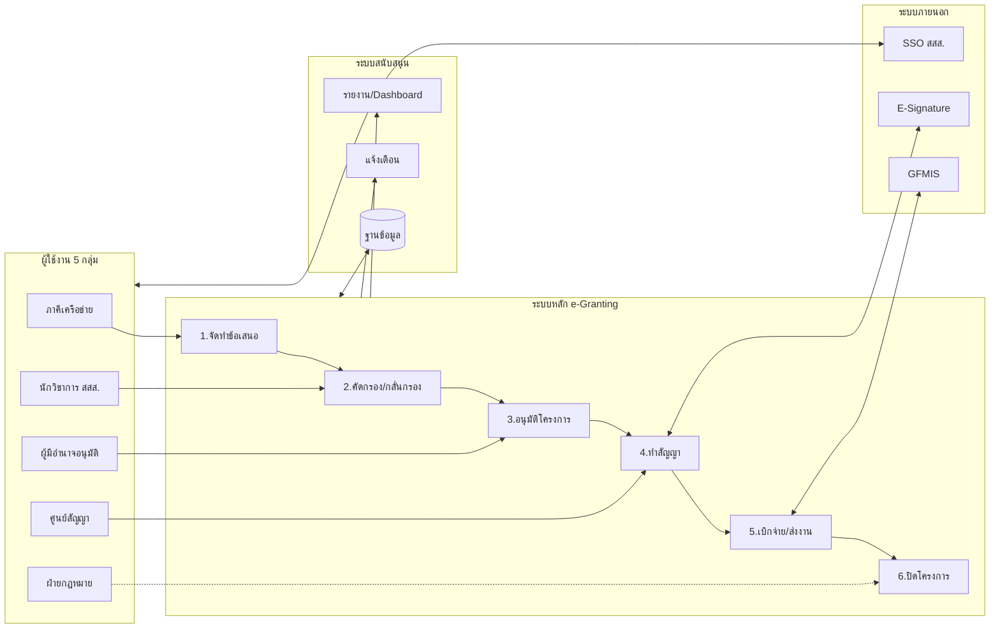

# ระบบสารสนเทศสนับสนุนโครงการ สสส. (ThaiHealth e-Granting System)

## System Architecture Diagram

---

## รายละเอียด Modules ตาม Grant Lifecycle

| Module | กระบวนการ | ผู้รับผิดชอบ | ฟังก์ชันหลัก |
|--------|-----------|-------------|-------------|
| **1. จัดทำข้อเสนอ** | พัฒนาข้อเสนอโครงการ | ภาคี + นักวิชาการ | กรอกข้อมูลโครงการ, วัตถุประสงค์, กิจกรรม, งบประมาณ, แนบเอกสาร |
| **2. คัดกรอง/กลั่นกรอง** | ประเมินความเหมาะสม | นักวิชาการ | คัดกรองขั้นต้น, กลั่นกรองวิชาการ, บันทึกงวดเงิน |
| **3. อนุมัติโครงการ** | พิจารณาอนุมัติ | ผู้มีอำนาจ | อนุมัติ/ไม่อนุมัติ/ส่งแก้ไข, กำหนดเงื่อนไข |
| **4. ทำสัญญา** | จัดทำสัญญารับทุน | ศูนย์สัญญา + ภาคี | ตรวจคุณสมบัติ, ลงนามอิเล็กทรอนิกส์ (E-Signature) |
| **5. เบิกจ่าย/ส่งงาน** | บริหารโครงการ | ภาคี + นักวิชาการ | ขอเบิกงวดเงิน, ส่งรายงานความก้าวหน้า, ตรวจรับงาน |
| **6. ปิดโครงการ** | สรุปและปิดโครงการ | ศูนย์สัญญา | ตรวจครุภัณฑ์, สรุปผล, อนุมัติปิด |

---

## Key Features

| Feature | รายละเอียด |
|---------|-----------|
| **E-Proposal** | ยื่นข้อเสนอออนไลน์, Auto-save, แนบไฟล์หลายรูปแบบ |
| **Multi-level Approval** | Workflow อนุมัติหลายขั้น (คัดกรอง → กลั่นกรอง → อนุมัติ) |
| **E-Contract & E-Signature** | ลงนามสัญญาอิเล็กทรอนิกส์, ลดเวลาจัดส่งเอกสาร |
| **Installment Tracking** | เบิกจ่ายเป็นงวด, ตรวจสอบรายงานก่อนเบิกงวดถัดไป |
| **Progress Monitoring** | ติดตามความก้าวหน้า, รายงานสถานะ Real-time |
| **PDPA Compliance** | รองรับ พ.ร.บ.คุ้มครองข้อมูลส่วนบุคคล |

---

## Technology Stack

| Layer | เทคโนโลยี |
|-------|----------|
| **Frontend** | React.js + PWA (Responsive) |
| **Backend** | REST API + SSO Authentication |
| **Database** | PostgreSQL + Redis Cache |
| **Security** | OAuth 2.0, SSL/TLS, PDPA Consent |
| **Integration** | API Gateway → GFMIS, E-Signature |

---

## ประโยชน์ที่คาดหวัง

| ด้าน | ผลลัพธ์ |
|------|--------|
| **ประสิทธิภาพ** | ลดเวลาดำเนินการ 40%, Paperless 80% |
| **ความโปร่งใส** | ติดตามสถานะ Real-time, Audit Trail ครบถ้วน |
| **การเข้าถึง** | ภาคีใช้งานได้ 24/7 ผ่าน Web/Mobile |
| **ความถูกต้อง** | ลดข้อผิดพลาดจากการคีย์ซ้ำ, Validation อัตโนมัติ |

---
*ออกแบบสำหรับ 1 หน้า A4 | Font: TH Sarabun New 14pt | Margin: 1 นิ้ว*
